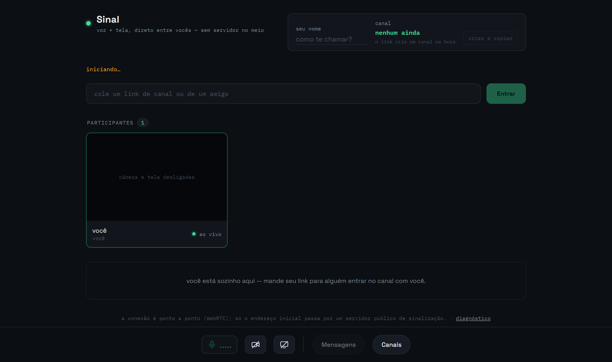
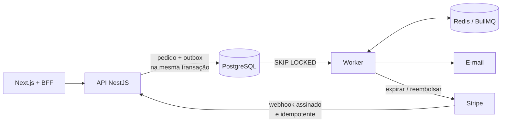

Gosto de problemas em que o detalhe técnico decide se a coisa funciona:
conexão direta entre navegadores, pagamento que não pode ser cobrado duas vezes, fila que não pode perder mensagem.

## Projetos em destaque

### 📡 [Sinal](https://github.com/ViniGHub/sinal-app)

Voz e tela **ponto a ponto** entre navegadores. [**Abrir o app →**](https://vinighub.github.io/sinal-app/)

<table>
<tr>
<td align="center" width="25%">🕸️ <b>Malha WebRTC</b> sem servidor de mídia</td>
<td align="center" width="25%">🔑 <b>Salas sem backend</b> o broker garante um dono por canal</td>
<td align="center" width="25%">🛡️ <b>TURN efêmero</b> credenciais via Cloudflare Worker</td>
<td align="center" width="25%">🎭 <b>E2E real</b> dois navegadores conectando no CI</td>
</tr>
</table>

### 🎟️ [TicketFlow](https://github.com/ViniGHub/TicketFlow) em desenvolvimento

Venda de ingressos com Stripe, projetada em torno do que costuma quebrar em pagamentos.

## Outros projetos

<table>
<tr>
<td width="50%" valign="top">

**[diplomas-microservices](https://github.com/ViniGHub/diplomas-microservices)** 
API e worker de geração de diplomas desacoplados por fila

</td>
<td width="50%" valign="top">

**[Santander_BI](https://github.com/ViniGHub/Santander_BI)** 
ETL de transações, API REST e painel de análise

</td>
</tr>
<tr>
<td valign="top">

**[meetup-app](https://github.com/ViniGHub/meetup-app)** 
App de meetups com banco e autenticação no Supabase

</td>
<td valign="top">

**[crypto-monitor](https://github.com/ViniGHub/crypto-monitor) · [crypto-report](https://github.com/ViniGHub/crypto-report)** 
Apps Android de acompanhamento de criptomoedas

</td>
</tr>
<tr>
<td valign="top">

**[poh-roulette](https://github.com/ViniGHub/poh-roulette)** 
Roleta com presets, animação física e efeitos sonoros

</td>
<td valign="top">

**[Controle-series](https://github.com/ViniGHub/Controle-series)** 
Controle de séries assistidas, com autenticação e CRUD

</td>
</tr>
</table>

## Como eu trabalho

<table>
<tr>
<td align="center" width="25%">🔒 <b>Tipagem estrita</b> TS strict e lint type-aware</td>
<td align="center" width="25%">🧪 <b>Teste certo</b> unitário, integração e e2e</td>
<td align="center" width="25%">🚦 <b>CI como portão</b> código quebrado não sobe</td>
<td align="center" width="25%">📝 <b>Decisões escritas</b> ADRs e limites conhecidos</td>
</tr>
</table>

## Stack

<table>
<tr><td><b>Linguagens</b></td><td></td></tr>
<tr><td><b>Front-end</b></td><td></td></tr>
<tr><td><b>Back-end</b></td><td></td></tr>
<tr><td><b>Dados e filas</b></td><td></td></tr>
<tr><td><b>Mobile</b></td><td></td></tr>
<tr><td><b>Infra e testes</b></td><td></td></tr>
</table>

## Formação

Projetos acadêmicos em parceria com Santander e Eurofarma.

